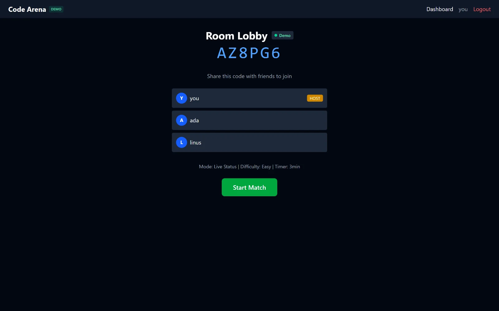
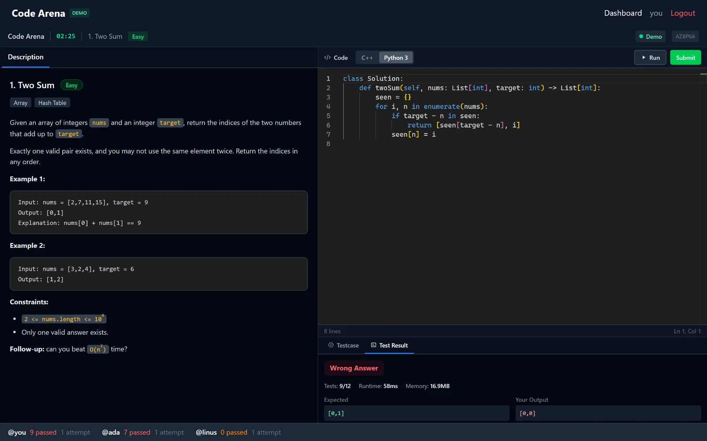
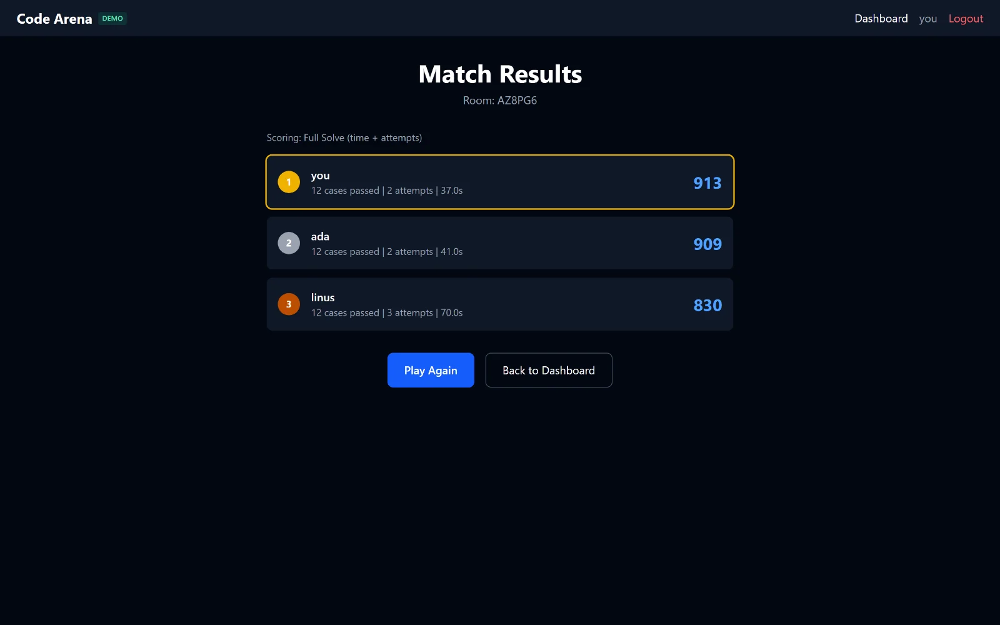
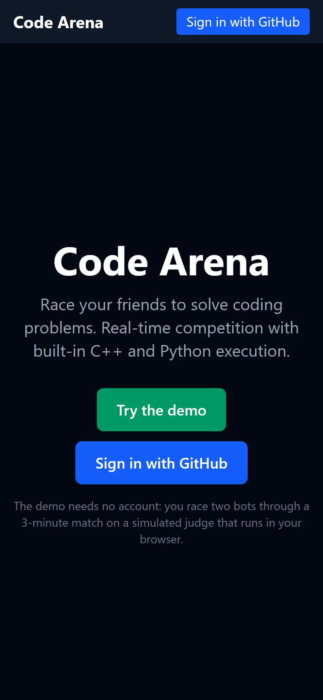
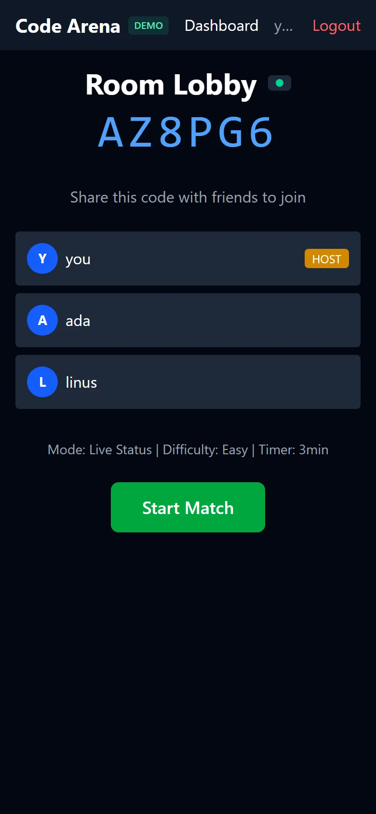
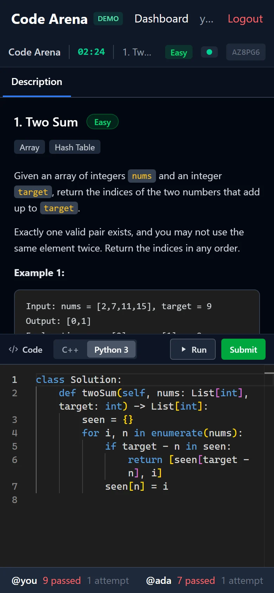
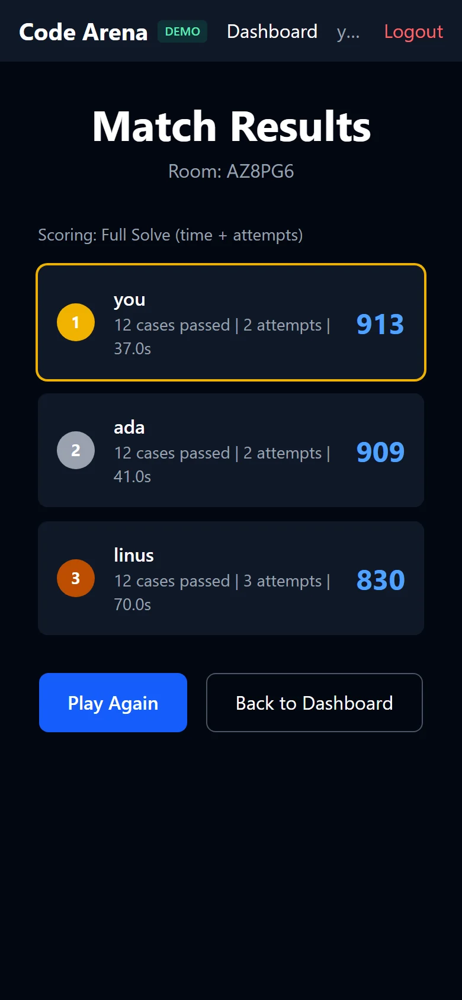
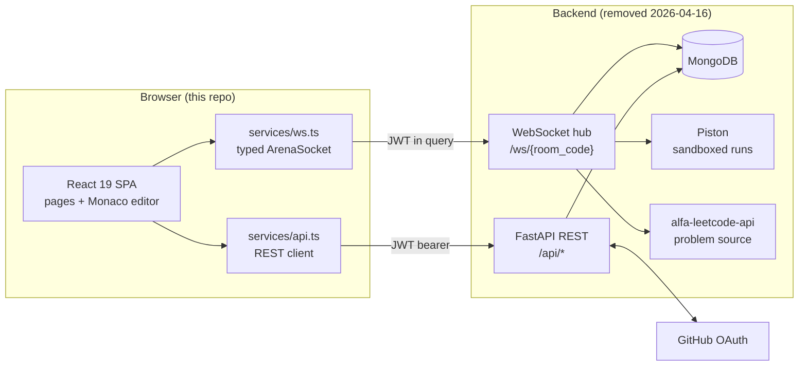
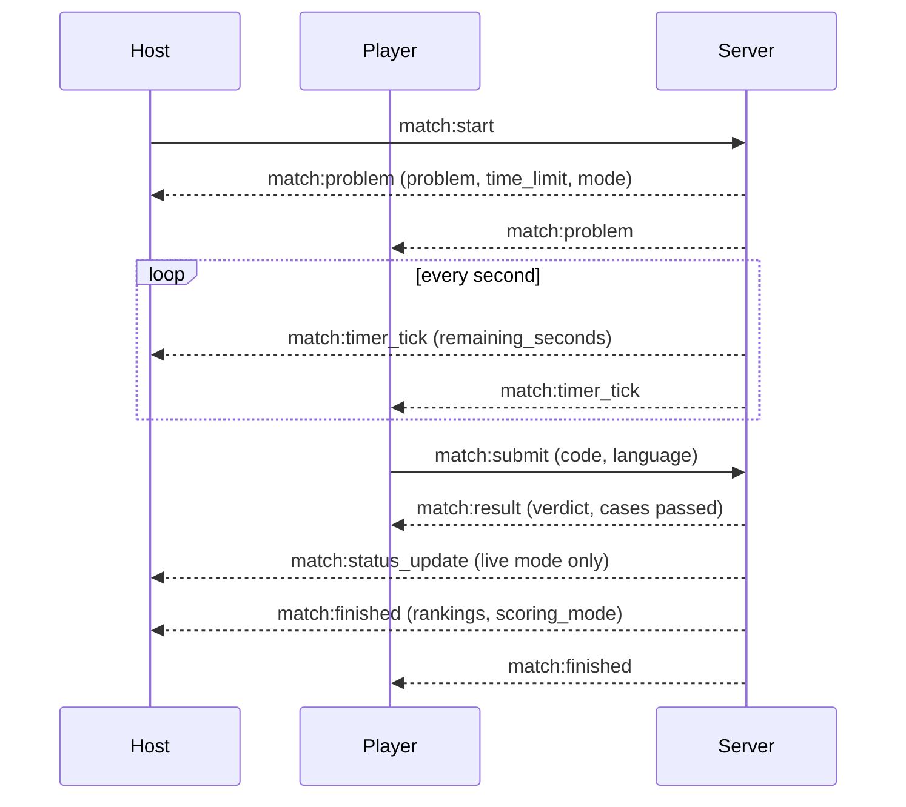
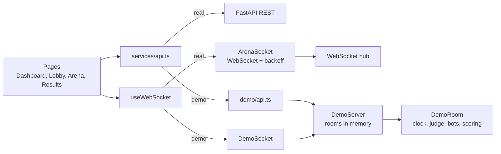

# Code Arena

[](https://github.com/Sagargupta16/code-arena/actions/workflows/ci.yml)
[](LICENSE)
[](https://sagargupta.online/code-arena/demo)

Frontend of a real-time competitive coding platform where 2-5 friends race to solve LeetCode problems.

**[Play a demo match](https://sagargupta.online/code-arena/demo)** -- no sign-in. You race two bots for 3 minutes, with a live status board and a final scoreboard.

> **Note:** This is a sample/reference project. The FastAPI backend was removed from this repository on 2026-04-16, so GitHub sign-in does not work on the hosted site. Demo mode replaces the backend with a small server that runs in the browser tab (see [Demo mode](#demo-mode)).

## Screenshots

Captured by [`frontend/scripts/screenshots.mjs`](frontend/scripts/screenshots.mjs), which plays one demo match in Chromium at 1440px and 390px wide.

| Lobby | Arena | Results |
|-------|-------|---------|
|  |  |  |

On a phone the arena stacks the problem, the editor and the test panel:

<p>
  
  
  
  
</p>

## Features

The UI implements the full arena flow, designed to run against a WebSocket backend:

- **GitHub OAuth** -- sign in with GitHub, no passwords
- **Private rooms** -- 6-character code, 2-5 players
- **Random LeetCode problems** -- filtered by difficulty and tags, with real function signatures
- **Built-in code execution** -- C++ and Python in sandboxed containers via Piston
- **Two modes** -- Blind Race (no peeking) and Live Status Board
- **LeetCode-style editor** -- Monaco Editor with language toggle, test cases panel, submission results
- **Server-authoritative timer** -- real-time sync via WebSocket
- **Scoring** -- speed + attempts + test cases passed
- **Demo mode** -- a full match against bots with no backend and no account
- **Reconnecting socket** -- exponential backoff and a connection pill in the lobby and arena

## Tech Stack

| Layer | Technology |
|-------|-----------|
| Framework | React 19, TypeScript 7 |
| Build | Vite 8 |
| Styling | Tailwind CSS 4 |
| Editor | Monaco Editor |
| Routing | React Router 8 |
| Sanitizing | DOMPurify (LeetCode problem HTML) |
| Tests | Vitest |
| Screenshots | Playwright |
| Hosting | GitHub Pages, deployed by GitHub Actions on every push to `main` that touches `frontend/` |

The former backend stack (FastAPI, MongoDB, Piston, alfa-leetcode-api, Docker Compose) was removed on 2026-04-16 and is not part of this repo.

## Quick Start

```bash
git clone https://github.com/Sagargupta16/code-arena.git
cd code-arena/frontend
pnpm install
pnpm dev
```

- Frontend: http://localhost:5173

To point the UI at your own backend, set `VITE_API_URL` and `VITE_WS_URL` (see `.env.example`). In dev mode, `/api` and `/ws` are proxied to `localhost:8000` (vite.config.ts).

| Command (in `frontend/`) | What it does |
|---------|--------------|
| `pnpm dev` | Vite dev server with the `/api` and `/ws` proxy |
| `pnpm lint` | ESLint (typescript-eslint, React Hooks, React Refresh) |
| `pnpm test` | Vitest: scoring, the demo judge, the demo room and the socket's reconnect logic |
| `pnpm build` | `tsc -b` type check, then the production bundle in `dist/` |
| `pnpm preview` | Serve the production bundle locally |
| `pnpm screenshots` | Play a demo match against `pnpm preview` and write the README screenshots to `docs/screenshots/` |

The suite has 24 tests in 4 files. CI runs lint, the tests and the build on pushes to `main` and on every pull request (Node 24, pnpm). The Pages deploy runs the tests again before it builds.

`pnpm screenshots` drives Playwright's Chromium; run `pnpm exec playwright install chromium` once if it is missing. Monaco loads from jsDelivr, so the run needs a network connection.

## Architecture

The repo holds the single-page app. The backend it talks to (FastAPI, MongoDB, Piston, alfa-leetcode-api) is described in [the design spec](docs/superpowers/specs/2026-04-03-code-arena-design.md) and is not in this repo.



A match, end to end:



### WebSocket protocol

Every message is `{ "event": "namespace:action", ...payload }`. Server payloads are typed once in `ServerEvents` (`src/types/index.ts`), so `socket.on("match:result", (data) => ...)` gets a typed `data` without casts.

| Direction | Event | Payload |
|-----------|-------|---------|
| Server to all | `room:player_joined` | `{ user }` |
| Server to all | `room:player_left` | `{ user_id }` |
| Host to server | `match:start` | `{}` |
| Server to all | `match:problem` | `{ problem, time_limit, mode }` |
| Server to all | `match:timer_tick` | `{ remaining_seconds }` |
| Client to server | `match:submit` | `{ code, language }` |
| Server to client | `match:result` | verdict, cases passed, time, memory |
| Server to all (live mode) | `match:status_update` | `{ user_id, status, attempts, test_cases_passed }` |
| Server to all | `match:finished` | `{ rankings, scoring_mode }` |

### Demo mode

`/demo` signs you in as a local player and swaps both transports for an in-browser server. Pages cannot tell the difference: they hold a `RoomSocket` and call the same `api` object either way.



- `DemoRoom` plays the backend's half of the protocol: lobby joins, a 180-second server-side clock, `match:result` after a short judge delay, `match:status_update` in live mode, and `match:finished` with rankings from the same scoring module the tests cover.
- Two bots (`ada`, `linus`) join your room and submit on a fixed schedule. Join any 6-character code instead and a third bot (`grace`) hosts and starts the match for you.
- The judge is simulated and runs no code. A submission that never returns a value fails every case, your first one that returns something is a near miss (9 of 12 cases), and the next one is accepted.
- Demo matches count toward the dashboard stats, kept in `localStorage`. Rooms live in memory, so a reload ends them.

### Design decisions

- **Server-authoritative timer.** The client never counts down on its own; it renders `match:timer_tick`, so every player sees the same clock and nobody gains time by throttling a tab.
- **JWT in the WebSocket query string.** Browsers cannot set an `Authorization` header on a WebSocket handshake, so REST uses a bearer header and the socket passes `?token=`.
- **Sanitized problem HTML.** LeetCode descriptions arrive as HTML and are rendered only after `DOMPurify.sanitize`.
- **Reconnect with backoff.** A dropped socket retries after 0.5s, 1s, 2s, 4s and 8s, then gives up and shows `Offline`. Close codes 1008 and 4000-4999 mean the server refused the connection on purpose (bad token, full room), so those never retry. `useConnectionState` reads the state through `useSyncExternalStore`, so only the pill re-renders.
- **Trace logs stay in dev.** Sent and received frames carry submitted code, so `[WS]` logging only runs when `import.meta.env.DEV` is true.
- **One socket per room and token.** `useWebSocket` returns the socket instance, so each page's effect lists it as a dependency and resubscribes cleanly (including under React StrictMode).
- **Results survive the page change.** `match:finished` fires once; the arena forwards the standings through router state so the results page does not wait for an event that already happened.
- **Deep links on GitHub Pages.** `public/404.html` and a small script in `index.html` (the spa-github-pages trick) turn a refresh on `/code-arena/room/ABC123` back into a client-side route.
- **Phone layout.** The arena stacks problem, editor and test panel vertically below the `md` breakpoint and goes side by side from `md` up.

## Project Structure

```
code-arena/
  frontend/
    src/
      pages/                   # Landing, Login, AuthCallback, DemoStart, Dashboard, Lobby, Arena, Results
      components/              # Editor, ProblemPanel, TestResults, Timer, ConnectionPill, Navbar, etc.
      hooks/                   # useAuth, useWebSocket, useConnectionState, useTimer
      services/                # REST client, WebSocket client, shared socket base, scoring
      demo/                    # In-browser demo server: rooms, bots, simulated judge, problems
      context/                 # AuthContext (GitHub OAuth + JWT, demo sign-in)
      types/                   # TypeScript interfaces
    scripts/screenshots.mjs    # Playwright run that captures docs/screenshots/
  docs/screenshots/            # README images (WebP, desktop and phone)
```

## How It Works

1. **Sign in** with GitHub OAuth
2. **Create a room** -- pick difficulty, mode (blind/live), timer settings
3. **Share the code** -- friends join with the 6-character room code
4. **Start the match** -- host starts, a random LeetCode problem is fetched with real function signatures
5. **Compete** -- write and submit code in the LeetCode-style editor
6. **Results** -- scored by speed, attempts, and test cases passed

## Scoring

- **Full Solve:** `1000 - seconds - (50 * failed_attempts)`, minimum 100
- **Partial (fallback):** when nobody fully solves, scored by `(passed/total) * 1000 - time_penalty`

## Known limitations

- No backend ships here, so GitHub sign-in does not work on the hosted site; demo mode is the way to try it.
- The demo judge is simulated: it never executes your code.
- **Run** and **Submit** send the same `match:submit` event; there is no separate "run against samples" endpoint.
- LeetCode exposes only sample test cases, so judging covers those, not the full hidden suite.

## Changelog

See [CHANGELOG.md](CHANGELOG.md).

## License

MIT
